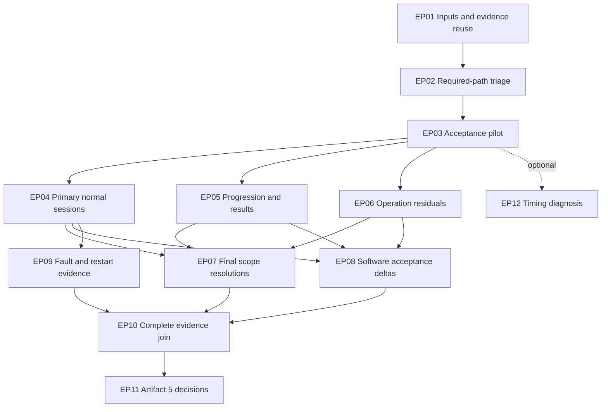

# Native rendering execution plan

Artifact 4 turns the [required gap register](../research/runtime/rendering-required-gaps-20261030.md)
into an ordered path against the unchanged [completion contract](native-rendering-closure.md).
The authored `execution_plan` in [the closure map](native-rendering-closure.json)
is consumed by `tools/rendering_execution.py`. It binds the exact contract and gap
section fingerprints, product source `648ce219` and planning base `7a5c43f4`.
**Every task is planned; supported-player acceptance and original recovery remain pending.**

The [artifact 5 acceptance record](native-rendering-acceptance.md) now tracks the
pending evidence obligations separately from this fixed plan. Opening it starts
EP01's source/lead-applicability review; actual build/input/provider identities and
the pilot remain pending. No task is completed by the opening/static guards.

The strategy minimizes unjustified new implementations and redundant execution:
reuse applicable proof, prove the acceptance pipeline once, share compatible
bounded sessions, then test residual required paths and provider differences.
This is an evidence-led dependency order. Durations and minimum run counts have
not been measured, so it is not a mathematically proven time-optimal schedule.

## Start here

**The next task is EP01: lock execution inputs and evidence applicability.**
Freeze the actual assembled source/compiler/binary closure, original/assets/save
identities and the two target configurations. Select concrete pilot inputs and
build a requirement/configuration applicability table from the 28 evidence leads.
The output is a new SQLite receipt, with unknown or unavailable fields explicit.
The existing static lead report seeds the review; it does not identify a newly
built player or validate an execution. Do not launch a capture against unnamed
inputs or refresh historical hashes to make old proof look current.

Use the existing strict-player target: native pixel ownership, RGB565 World,
640x480 and 800x600 with rebuild/rebind, native lighting/capture disabled, enabled
movies, default OpenGL and the software variant. Record actual host/provider,
display, music/voice and source/input choices. No immediate product decision is
required to begin EP01 or the technical triage.

The following isolated checks prepare the evidence work and do not complete EP01:

```sh
python3 -B tests/test-drawing-journeys.py
python3 -B tests/test-drawing-session.py
```

They check admission/accounting with synthetic fixtures. The static plan review
already runs them. For subsequent original-consuming executions, apply the storage
guard, choose bounded output/retention first, and verify the original manifest
before and after. Keep durable reports in SQLite through `coverage_evidence.write_report`.
The local drive reserve must be checked again before any build or capture.

## Dependency order and exits



EP01 is also a direct prerequisite of the pilot; EP02 supplies requiredness inputs
to EP07. After a successful pilot, EP04–EP06 can progress independently, consuming
each other's observations when useful. After healthy normal lifetimes, faults can
be tested while scope and software evidence are being completed. These are logical
work opportunities, not a requirement to run concurrent game sessions or agents.

| Task | Concrete deliverable and exit |
| --- | --- |
| EP01 — Inputs and applicability | Hash-bound actual execution inputs and scoped reuse/remaining-work rows for 28 evidence leads; named finite pilot/domain candidates. Missing provenance blocks its affected run. |
| EP02 — Required-path triage | All eight decisions have a required observation or precise candidate boundary, affected claims and an engineering owner. Final resolution is not required before unrelated useful work. |
| EP03 — Acceptance pilot | A current default public-player action has independent contiguous composed-World output/history, actual acknowledgements/effects and normal Quit/resource evidence. Add a small software-provider probe. Offline replay alone cannot pass this gate. |
| EP04 — Primary normal sessions | Current default evidence for movie/menu/Quick Battle, sustained World, camera/effects/HUD/cursor, pause/preferences, Save/Load and shutdown leaves, with actual actions and complete required output/history. |
| EP05 — Progression and results | Actual campaign entry, later-map progression, victory, defeat and result return, including first-frame history and populated ownership handoffs. Reload is not map progression. |
| EP06 — Operation residuals | Adequate independent proof for required copy/write/history/text/image/sprite/palette/caller-state scopes; concrete current relevance of the two retained negative observations. Reuse scoped proof before new tests. |
| EP07 — Scope resolutions | Evidence-backed closure or exact justified applicability boundary for each decision required by the claim. Required unknowns stay blocking; support-domain and original-recovery limits are explicit. |
| EP08 — Software deltas | Complete software requirement coverage with actual provider-sensitive output, transitions/input/media/lifetime evidence and explicit per-requirement reuse. Both target configurations remain required. |
| EP09 — Fault/restart | Expected failure/error/state and process/channel/native-owner retirement; fresh-generation restart and required loss/restore semantics. Isolated recovery and physical reset keep separate claims. |
| EP10 — Evidence join | All 14 journeys/47 leaves, 21 operations, ten gates and required boundaries reconciled by exact source/configuration, preserving every failure and pending row. |
| EP11 — Artifact 5 | Executed acceptance dossier and separate supported-player/original-recovery decisions. A positive decision requires adequate current evidence; pending/fail is a valid recorded outcome. |
| EP12 — Optional diagnosis | Current bounded timing/cost measurements when useful. No mandatory task depends on this diagnostic or a fixed FPS floor. |

Every one of the 36 gap-register closing briefs has one accountable execution owner.
A task contributes evidence to its linked brief; its plan entry or a successful
command does not automatically close a requirement across configurations.
Detailed actions, artifacts, exact exits, reuse paths and failure responses are in
the authored plan. Reuse requires matching requirement, source, caller/provider,
configuration and reference boundary; a fresh hash alone does not establish adequacy.

## Prove the pilot before expanding

The default pilot is a bounded main/setup → Quick Battle → first composed World →
one camera/cursor action → normal original Quit route. Start early enough to own
the required initial pixel history. Check native Qt UI policies semantically;
do not demand original UI layout identity or silently treat World pixel mismatch
as intentional UI policy. Add an early software probe to expose provider failures
before long sessions. Full software acceptance remains EP08.

Existing generic admission and backend interfaces in `tools/drawing_session.py`
already require independent acquisition, contiguous frames, action/input identity,
oracle separation and caller-visible results. The shipped suite has seven cases:
four component/scene/publication cases, one recorded session and two recorded-action
sessions. It has **zero generic presented-frame session cases**. Recorded action
bindings retain their observed-EGL boundaries and do not close full journeys.
EP03 must connect or extend the smallest necessary collector/backend/case pieces
and bind actual current public-player integration. It must not relabel an old case
or prescribe a general renderer rewrite because the acceptance plumbing is missing.

If the pipeline cannot produce one valid receipt, **stop broad acceptance reruns**.
Preserve the failure, distinguish missing evidence plumbing from a reproduced
required engine defect, fix the smallest established gap and repeat the pilot.
Neither original output fed to native rendering, sampled frames, a clean exit,
all successful emitted COPYs nor an offline replay alone closes the public-player claim.

## Share runs without merging distinct outcomes

Seven candidate session packs cover compatible work: entry/media,
World/interaction, storage/display, campaign/next-map, victory, defeat and fault
lifecycle. They are scheduling candidates, not seven promised executions or a
replacement denominator. Natural movie completion and skip need their own branches;
victory and defeat may need separate runs. Preserve complete history within every
claimed interval, actual callback acknowledgements and resource identities.

Extract operation and supplier observations from these runs before scheduling
residual comparisons. One component result can be reused only for its exact scope.
Required natural callers need actual evidence or a precise justified boundary;
zero observations do not prove global absence. Ordinary normal sessions and
expected faults remain separate. Existing worker recovery and restart mechanisms
are reused before proposing another implementation.

## Engineering findings and user choices

The [technical scope review](../research/runtime/rendering-scope-decisions-20261030.md)
clarifies this fixed plan: the already exposed Qt toolbar/F9 fullscreen transition
belongs to EP04/EP08 validation, and RGB555 offscreen surfaces are already admitted
by the facade. Neither should be treated as an optional feature awaiting a user
preference. Original exclusive/padded behavior and live RGB555 World production
retain their separate boundaries. The release-domain promise is the only current
scope category that may need a later product judgment; technical proof is not a
reason to ask the user to choose how the engine behaves.

All eight scope decisions remain engineering-owned investigations. Alternate
storage ownership, natural callers, required history, screen/vtable lifetimes
and actual format production are facts to establish. A required in-scope path
cannot be dropped merely because it is inconvenient or unobserved.

Two product-choice categories may eventually need the user's judgment:

- **Supported domain:** engineering selects concrete maps/saves/profiles and
  demonstrates actual later progression and both results. If the release promise
  extends beyond that demonstrated finite domain, present the broader promise,
  cost/consequence and a recommendation. No arbitrary-map/save/duration claim is
  inherited from two Quick Battle maps or twelve minutes of play.
- **Additional compatibility:** use the reviewed target while investigating
  required paths. Extra fullscreen/padding, RGB555 or physical/legacy-platform
  promises need an explicit proposal. If one is already required by an existing
  journey, recover/implement/validate it or explicitly review a contract amendment;
  calling it an expansion does not silently exclude it.

Neither category blocks creation of this plan or EP01. Ask only when a concrete
support-promise choice is needed, with evidence, a recommendation and its effect
on completion. No user selection is inferred from elapsed time or this static review.

## Repair, rerun and close

Retain a new failure receipt → establish requiredness/provenance → isolate the
smallest concrete gap → implement a bounded fix if needed → rerun affected proof
and consumers → join new evidence IDs. Review dependency/consumer scope when a
source/input/configuration changes; preserve historical hashes and avoid rerunning
unrelated subsystems. Shared pipeline/history changes require a fresh pilot.
Unexpected normal refusals remain failures; do not relax admission to erase them.
The retained cursor refusals and late-history mismatch need current relevance
before being called current defects. Optional FPS diagnosis stays off the path;
required response, progress and resource checks remain on it.

EP10 hands actual evidence to artifact 5. Supported-player acceptance and original
recovery receive separate decisions; a bounded accepted player may retain original
recovery gaps. This static plan does not execute the tasks or certify either claim.
The [review record](../research/runtime/rendering-execution-plan-20261030.md)
records source/contract checks, guards and local accounting.


## EP03 execution update — 2026-10-31

The [public acceptance pilot](../research/runtime/rendering-acceptance-pilot-20261031.md)
closes the bounded EP03 pipeline with a real current execution/admission receipt.
The default public entry, enabled intros, first offered Quick Battle, actual World
swaps, Qt input consumed at an original callback, independent continuous history
and normal original Quit are connected. All 113 captured native swaps matched,
including 58 World presentations across 44 original-reference Worlds. The actual
software flag probe completed the route; full software pixel acceptance remains
EP08 work. Integer sharp on Xvfb/llvmpipe is the demonstrated viewport/provider.

The frozen plan retains its authored state and witnesses; this dated execution
receipt supplies progress without rewriting that historical contract. EP01/EP02
are concretely bound for this pilot's inputs, not for the entire future support
domain. EP04/EP05 are the next expansion, with EP06 residuals and EP08/EP09
configuration/fault proof. EP10 still needs a complete per-requirement join before
EP11 can issue independent player/recovery decisions. All 156 broad obligations
remain pending; none is automatically closed by a pipeline receipt. No immediate
user decision blocks the next engineering work.


## First EP04 execution batch — 2026-10-31

The [reviewed batch](../research/runtime/rendering-normal-acceptance-20261031.md)
fixes actual Qt fullscreen extent, mandatory native history before original
campaign Preferences, and Preferences readiness arriving in its opening ACK.
Current default Quick/high-storage/low-storage proof matches 1,410 recorded World
swaps against 1,157 original-reference Worlds. Both 640×480 and 800×600 Worlds,
original Save/Mini Load/Main Load, two applied display rebuilds, changed-draft
Cancel and normal Quit are connected to independent history/presentation proof.

The unchanged contract now has six admitted default leaves, 150 pending rows and
both verdicts pending. Exact auxiliary-driver reuse is reviewed against all 14
retained high-mode decisions; native/capture source drift cannot use that rule.
Software, other normal/progression/input/media/caller/fault cases and full recovery
are not closed. The [progress snapshot](../research/runtime/rendering-normal-results-20261031/progress-01.json)
retains the finite positives and the unresolved first-World watchdog failure.

Next: isolate `RN31.G.first-world-watchdog` with enabled-intro source/command/CPU-read
and owner/media timing, preserve each attempt, and establish repair/applicability
before any supported-player verdict. Then complete remaining EP04 camera/picking/
HUD/resume cases, EP05 progression/results and EP06/EP08/EP09 residuals. EP10's
complete per-requirement join and EP11's separate decisions remain required. No
immediate user support-promise choice blocks this engineering work.
