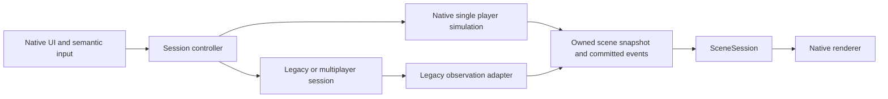

# Native single player engine completion plan

Reviewed against local master `02a07b2b6aa99b8342842e141fa789efcd90cf08` on
2026-11-09. This is a planning baseline, not new engine execution or a status
promotion. The [behavior register](../research/runtime/coverage/register.json)
and its source-bound evidence remain authoritative for demonstrated behavior.

The target is native ownership of original single-player gameplay, delivered in
playable increments using the existing native renderer and recovered libraries.
Multiplayer stays on the existing original/Wine implementation. Rehosting the
original executable without Wine is a separate project and is not a prerequisite.

## Completion scope and retained implementations

The baseline is the pinned No-CD build already used by reconstruction, with
installed original assets and classic rules. Complete single-player means the
original campaign from new game to final completion, its playable wizard and
difficulty choices, and single-player Quick Battle. Phase S0 must enumerate the
actual maps, creature profiles, spells, objects, objectives and branch conditions
before assigning a closed denominator. A small crop or an authored campaign is
an intermediate milestone, not the release domain. Unknown required content
remains a gap. Changes to this target require an explicit scope amendment.

| Responsibility | Final owner or policy |
| --- | --- |
| World state, scheduling, entity lifetimes, navigation, combat, AI, spells, scenario and campaign progress | Native single-player simulation; no original simulation callback or hidden fallback in an accepted native session |
| Rendering and scene presentation | Reuse native renderer and SceneSession; preserve their independent rendering acceptance requirements |
| Native checkpoints and campaign continuation | Native, with complete resource and continuation restoration |
| Multiplayer, networking and original multiplayer saves | Existing original/Wine backend; retain its current supported scope without adding a networking rewrite |
| Existing original saves | Remain usable through the legacy backend. Native import/export is optional follow-up; structural decoding does not establish playable restoration |
| Audio output, movies, menus and asset decoding | Reuse current services and backends. Declare each dependency; Windows-backed peripheral services may remain isolated where they do not own gameplay decisions or state |
| Reference execution and diagnostics | Original executable and Wine may remain research tools |
| Commander enhancements, veterancy and revised mana economy | Deferred until the classic baseline is validated; separate rule profile and balance work |
| Other executable builds, native networking, broader platform support | Separate milestones |

Select native single-player or legacy/multiplayer before session creation. Each
backend owns its whole session, save namespace and lifecycle. Do not switch a
running world between engines. Unsupported native content must refuse before
starting or terminate with a retained diagnosis, without silently continuing in
the original engine. Keep existing legacy launch behavior available explicitly.

Track three different verdicts: **native simulation complete**, **integrated
native single-player accepted**, and **Wine-free single-player deployment**.
The first requires no original gameplay execution; the second additionally
requires usable presentation/input/media and full journeys; the third requires
retiring any remaining Wine-backed peripheral services. Multiplayer may continue
using Wine after any of these verdicts.

## Assessment of existing structure

The architecture already separates native state, build-specific reconstruction,
services, presentation and injected adapters. Preserve those boundaries. The
missing structure is a complete composition and acceptance contract: which
provider supplies every required consequence, who owns its continuation, and how
all supported content reaches native execution.

| Area and existing starting points | Remaining gap and consequence |
| --- | --- |
| [World and persistence](../game/README.md), `WORLD.owned`, `NP.checkpoints` | Native handles, staged ticks and snapshots exist. Their native policies do not complete original tick scheduling or entity lifetimes (`GP.tick`, `GP.lifetime`). |
| [Command session](../apps/command-session/README.md), `AI.native-command-session` | Canonical commands and providers compose real recovered bodies. Dense fixed actors, supplied consequences, profile refusals and opaque backend continuation still limit general worlds. |
| [Installed encounter](../apps/native-encounter/README.md), `NP.native-owner-skirmish`, `NP.native-wizard-encounter` | Ordinary battles and selected wizard effects execute natively. Species, strategic families, dynamic factories and full World services are not covered by these bounded encounters. |
| [SceneSession](../apps/scene-session/README.md), [scene renderer](../renderer/scenes/README.md) | An owned semantic presentation interface exists. Complete original world extraction, visual providers, picking side effects and lifecycle composition still need scoped proof. |
| [Cell production](../research/runtime/native-world-cell-producer-20261020.md), [actor lifecycle](../research/runtime/native-actor-lifecycle-20261020.md) | Recovered orchestration is reusable, but external animation, occupancy, owner, resource and other callbacks still supply behavior. Native entry execution is not complete service ownership. |
| [Campaign applications](../apps/skirmish/README.md), `NP.campaign-session`, `NP.campaign-graph` | Native persistence and authored objectives/graphs exist. Original scenario semantics, rewards and full campaign progression (`GP.progression`) need implementation and comparison. |
| [Original persistence research](../research/runtime/persistence-progression.md), [saved world decoder](../assets/save_world.hpp) | Envelope/block decoding and byte retention are not semantic restoration of active tasks, identities, resources or pending events. Keep legacy saves on the legacy backend until an explicit importer is proved. |
| [Simulation dashboard](../apps/coverage-ui/tracks.json) | Fifteen capability milestones provide useful indexing, not a release checklist. Broad GP entries and narrower successful components must both remain visible. |

## Gaps to close explicitly

These planning gaps are not new behavior claims. Each implementation batch must
link or seed precise behavior IDs before changing an engine contract.

| Gap | Required resolution | Existing accounting anchors |
| --- | --- | --- |
| G1 Content denominator | Enumerate required content and branch families; bind each to an implementation, scenario and evidence or a pending gap | `GP.ai`, `GP.combat`, `GP.cast`, `GP.progression` |
| G2 Provider dependency closure | Inventory supplied, original-forwarded, native-policy and native-recovered services; identify reads, writes, allocations, failure paths and remaining original callers | `AI.native-command-session`, `NP.native-owner-skirmish`, `NP.native-wizard-encounter` |
| G3 Time and randomness | Establish authoritative admission, pause, alternate modes, work budgets, update order and RNG consumption; separate presentation clocks from gameplay | `GP.tick`, `GP.threading`, `MV.pause-clock` |
| G4 General ownership | Replace fixed encounter assumptions with validated factories, map membership, cleanup/release, observer invalidation and resource retirement | `GP.lifetime`, `WORLD.owned`, `RS.actor-pool-storage`, `RS.actor-release-cascade` |
| G5 Original rules versus lab policies | Label and retire or explicitly retain each authored cadence, scoring, allocation, movement and summon policy; preserve original balance | `NP.native-owner-skirmish`, `NP.native-wizard-encounter`, `AI.wizard-controller` |
| G6 Full continuation | Persist every timer, queue, RNG stream, task, animation event, ownership relation and resource binding; define upgrade/refusal rules | `NP.checkpoints`, `NP.command-continuation`, `NP.campaign-persistence` |
| G7 Original campaign semantics | Recover mission scripting/dispatch, triggers, learning, inventory, rewards, defeat/retry and transitions across all required content | `GP.progression`, campaign `CP.*` contracts |
| G8 Integration and authority | One simulation owner, semantic commands, explicit presentation snapshot and event publication; no double tick or dual authoritative state | `WORLD.sandbox`, `AI.native-command-session` |
| G9 End-to-end proof | Original/native differential execution, cold continuation, full campaign journeys, resource conservation and original-call absence | Relevant component IDs plus `GP.tick`, `GP.lifetime`, `GP.progression` |

## Ownership and the scene boundary

The shared snapshot path from the legacy adapter is a target integration to prove,
not a claim that all current legacy modes already use SceneSession. Retain the
current working rendering route while establishing it.

Simulation owns gameplay animation events, positions, health, visibility knowledge,
collision, entity generations, command eligibility and RNG. Presentation owns
camera composition, visual-only channels, decoded visual resources and GPU state.
Rendering an unchanged snapshot must not advance gameplay. Keep render occlusion
separate from AI perception and fog knowledge. A click returns a stable candidate
identity and coordinates; simulation revalidates eligibility at command admission.

Snapshots must bind session epoch, tick, entity/resource generations, map revision,
authoritative animation displays, attachments and lighting inputs. Values crossing
the boundary are owned or explicitly leased; original pointers never become native
entity handles. Inventory any recovered drawing-time history, RNG, picking or
visibility mutations and assign an explicit owner and ordering before bypassing
the original producer. A read-only snapshot alone does not reproduce those effects.

Keep `game/` independent of Qt, Wine and build addresses. Keep recovered bodies in
`reconstruction/`; compose them through native interfaces. Extract reusable portions
of `apps/command-session` as concrete consumers need them, preserving standalone
tests. A directory reshuffle or root CMake project is not a prerequisite for the
first vertical slice. Avoid maintaining a new parallel implementation of the
already recovered command, navigation, combat or scene libraries.

## Ordered delivery stages

Every stage delivers a runnable artifact and a bounded pass/fail decision. S0 and
S1 establish the initial contract; S2 and S3 can then progress independently.
Later systems may be investigated earlier, but their integration gates depend on
the stages listed. Existing applicable proof should supply inputs whenever possible.

| Stage | Work and dependencies | Deliverable and exit condition |
| --- | --- | --- |
| S0 Scope and service inventory | Inventory the fixed single-player content domain, provider callbacks, lab policies and applicable evidence. Follow the actual production composition, not only header declarations. | Reviewed content/provider matrix with owner, original entry/build, state, continuation, implementation, scenario, evidence and pending gap for each required service. Every unknown is assigned a closing task. Freeze the release denominator before claiming coverage. |
| S1 Executable comparison and continuation harness | Reuse native encounter, command and original replay tools. Normalize identities without hiding ordering, RNG draws or state differences. | One existing encounter executes with repeatable input, seed and initial state; native uninterrupted and fresh-process resumed outcomes agree. Original comparison states exactly which lower services are real versus supplied and retains the first divergence. No whole-world promotion. |
| S2 Scene boundary pilot | Use S0/S1 and existing SceneSession; bind one installed map/profile to semantic state. Keep simulation ownership unchanged. | Same identified world produces repeatable frames and picking through the native boundary. Camera redraw does not tick gameplay; destruction/reuse, pause and restored epochs retire old visual state. Compare original order, required mutations and final output within the declared scene. This is a scene milestone only. |
| S3 World scheduling and dynamic ownership | Close G3/G4 using recovered scheduler, actor lifecycle and map services. Integrate ordinary movement and native command publication. | Headless map creation, spawn, command, tick, cleanup, release, reuse, save and cold resume. Compare original scheduling/lifetime events and relevant state, including budget exhaustion, pause, target deletion and occupied movement. Remove fixed-actor and authored-cadence assumptions for this slice. |
| S4 First playable native encounter | Compose S2/S3 with recovered ordinary AI, health, melee, movement, assets and input; select one representative installed map/profile. | Launch without original gameplay execution; move, fight, die, pause, save/resume and quit. Produce a dependency/call audit showing no original gameplay callbacks. Use current renderer; this bounded playable milestone does not close the campaign. |
| S5 Creature and world service breadth | Extend S4 through every required creature/action/motion/interaction family, world object, terrain and perception branch from S0. | Required families have original comparisons and integrated scenarios covering interactions, dynamic ownership and continuation. Explicitly cover rare/special movement, ranged/action branches and environmental consequences; no silent generic substitute. |
| S6 Wizard strategy and complete spell families | Build on S4; integrate onto S5 as world families become available. Recover selection/scoring, mana, inventories, factories and effects through retirement. | Every required spell family and wizard task maps from candidate/admission to consequence and cleanup. Mixed encounters cover summoning, resource depletion, interruption, caster/target death and saving during effects. Baseline values and RNG order are checked. |
| S7 Original campaign and Quick Battle | Compose S5/S6 with original scenario initialization, objectives, scripts, rewards, transitions and native campaign persistence. | New-game paths through campaign completion plus defeat/retry and all required Quick Battle configurations. Missions and unique branch families are individually accounted for; one complete playthrough cannot cover every branch. Cold resumes work before/after settlement and map transitions without duplicate rewards. |
| S8 Supported native player acceptance | Join S7 with current rendering/input/audio/menu evidence and backend routing. | Complete single-player journeys, practical responsiveness, bounded storage/memory, normal and failed-session retirement, content coverage and no original gameplay calls. Verify legacy multiplayer selection still routes to its existing backend. Publish the separate simulation, player and Wine-dependency verdicts. |

The first scheduling task is the actual tick/admission contract, not a chosen
fixed frequency. The first ownership task is a real spawn-to-release journey,
not just allocation of generation handles. Native rollback protects internal
state; publish audio/UI/filesystem effects only after successful commit and check
that replay or restore does not duplicate them.

## Acceptance and evidence discipline

For each stage, keep understanding, implementation, isolated original comparison,
headless integration, presented integration and live replacement separate. A test
with supplied callbacks proves its caller's contract only. Final integration must
close the real transitive providers for its supported content.

Use an acceptance matrix with rows for content/behavior families and columns for
initialization, ordinary execution, interruption/failure, save/resume, teardown,
original comparison and native integration. Each cell names evidence or an explicit
pending obligation. Keep this as authored contract data once a real tooling/UI
consumer is added; generated observations and reports belong in SQLite. Do not
manufacture a completion percentage from line counts or broad GP entries.

Require these cross-cutting scenarios as they become meaningful: command on a
stale target; death during an action; summon into occupied terrain; actor/effect
reuse; pause with pending events; exhausted planning budget; save during movement,
combat and casting; missing/mismatched resource at restore; mission outcome with
queued work; repeated map transitions; normal Quit and failed startup/teardown.
Retain corruption/refusal tests and native policy boundaries separately from
original valid-state equivalence.

Choose numeric performance, response and resource bounds against named supported
hosts and content during S0/S1, before acceptance runs. Distinguish simulation
tick progress from render FPS; benchmark realistic populations and long-lived
queues. Do not infer performance from a copied-state lab or render smoothness.
Full-state per-tick copies and replay-based restoration need measurement before
admitting the full content domain.

For every implementation batch, update exact behavior/source/scenario links and
the coverage ledger. Inspect evidence applicability before new original runs;
prefer retained-data comparisons for analyzer changes. Preserve every failed run
and original source phase. Run the audit and change gate for the owned changes;
do not reset historical hashes or rerun unrelated matrices to make them fresh.
No new original-game execution budget is granted by this plan.

## First bounded work packages

1. **Provider audit:** trace `CreatureRuleSession` through command-session native
   providers, encounter profile construction and wizard/owner consequences.
   Produce S0's matrix, naming every original callback and supplied policy.
2. **Content audit:** enumerate installed single-player content and scenario
   dispatch; classify unsupported branches. Use retained inventories first.
   Required unknowns block full completion, without blocking the first slice.
3. **Continuation audit:** inspect CMD1 and world/campaign codecs against the
   provider matrix. Identify state outside snapshots and nontransactional effects.
4. **Harness baseline:** select existing original/native encounter evidence,
   review applicability, and establish S1's state/event comparison and cold resume.
5. **Pilot selection:** choose S2/S3 cases from that inventory with explicit
   scope, inputs, failure cases, resource budget and exit conditions. Re-estimate
   later work from these measured batches; the earlier conversational effort
   multipliers are not a schedule or a completion baseline.

Complete each package with an inspectable result before enlarging its scope.
Reuse the renderer and current services throughout; a parallel engine rewrite
would discard useful recovered contracts without resolving the missing behavior.
