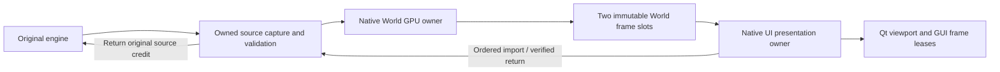

# Separate native World GPU production

Experimental native policy, selected by `MNM_ASYNC_WORLD_GPU=1` / campaign
`--async-world`, requires independent resident delivery and retained World images.
A dedicated native GPU owner consumes the same strict owned-V5 source sequence.
The presentation owner polls completed immutable GPU snapshots and can present
the previous World while production runs. Both original source credits and the
two immutable GPU export slots remain bounded; original verified return follows
ordered command import. No simulation clock, balance, wire, original drawing or
DirectDraw fallback changes. Platform targets are created on the GUI thread.

The producer retains GPU slot ownership until all consumer leases return.
Application shutdown releases command imports before World frames and joins the
producer before destroying platform surfaces. Production exceptions close the
queue; sequence gaps and exhausted admission refuse. Joining requires callers
to return all consumer leases, and callbacks must finish; arbitrary driver hangs
are outside this bounded policy. Stage capture profiling remains a separate mode.

## TITAN controls and remaining live boundary

Source-bound TITAN controls will exercise presentation during an authored blocked
producer, slot leases, two outstanding jobs, ordering, terminal failure and joined
cleanup. A contiguous captured prefix will compare every imported native word
with same-input synchronous production. Diagnostic readbacks are controls only.
Full live casting/combat/spells/portraits/menu resumes/normal Quit, balanced source
and GPU counts, ordinary zero readbacks and performance remain pending. This is
not original equivalence, interpolation, scanout or sustained60FPS evidence.

`run-cfe19qzn` passes on TITAN RTX/Zink with source/input/original manifests
stable: all128 real consecutive World frames match every imported native word
against synchronous production, with zero ordinary producer readbacks. An
authored100ms producer delay permits17 consumer presentations of the prior
immutable frame. Two simultaneous output leases preserve old pixels and prevent
reuse; the two-job bound, skipped sequence refusal, terminal exception refusal
and joined owner cleanup pass. Default and asynchronous worker controls both
pass172 native presentations,25 diagnostic framebuffer hashes, two export leases,
movie-pause behavior and malformed-source refusal. Existing GPU presentation
controls pass. These controls prove the declared handoff, not live gameplay FPS.

Earlier `run-y5ic6ij5` retains the same128-word-comparison/queue successes but
fails the worker trace assertion because the runner omitted required trace
settings. The corrected runner enables the fixture trace and cadence settings.
That failed result receives no successful execution claim.

Production wall time includes immutable GPU export and driver waits; its first
job also includes cold native asset/session setup. The presentation owner's
`active_world_poll` now measures admission/completion bookkeeping rather than
native World execution. These are different spans; compare their scope rather
than treating a smaller poll time as reduced total World work.

## First complete public result (historical source)

Candidate `run-q5jyiyuf` / experiment `run-f1z4k53x` passes the complete TITAN
journey: casting/combat, movement, spell/portrait checks, three menu resumes,
Quit-No resume and normal Quit. All5268 native Worlds/image captures/imports/
verified returns/GPU submissions/productions/completions balance. Both source
and GPU outstanding counts retire to zero, high-water bounds are two, immutable
producer allocations are two, and ordinary readbacks are zero. Source/shell
identity, original manifest checks and private Wine cleanup pass. The retained
lifecycle log contains no GAP or copy-order timeout.

Engine delivery is19.58158 updates/s and native World presentation57.18977FPS
(visible trace57.72239FPS). The246 gameplay windows average72.56326 native
presentations and72.57122 GUI paints/s; their worst window is52.89421FPS.
These UI counts include native presentation events beyond World refreshes and
do not establish stable60FPS World delivery, animation interpolation or scanout.

World production averages13.83526ms including immutable export and cold setup;
render-owner active World poll averages0.007502ms, maximum0.044728ms. Repeated
World frame access averages0.000382ms, while native UI composition averages
1.21234ms. Moving work off the presentation owner does not remove World work.
A same-build synchronous baseline is still pending; previous live inputs differ
and cannot support a causal FPS percentage. Original simulation/UI production
remains retained as reported; native command fallback is false.

## Synchronous retirement regression found by the paired baseline

`run-5352r9gj` completes its scripted gameplay flow but fails the native normal-
Quit gate. Its5108 World/import/verified-return/accepted/returned counts are
balanced and no work is outstanding; this is not a successful lifecycle result.
The new asynchronous GPU-count guard was accidentally applied to the synchronous
path, whose absent GPU queue has zero counts. Consequently any nonzero completed
World count was rejected. This is a confirmed error in this experimental change,
not an unexplained OS/notification race. The mode-specific retirement predicate
now applies GPU counts only to the asynchronous owner, while both modes retain
all accepted-Quit, source/import/return and pending-work checks.

The regression control uses4498 completed synchronous Worlds with no GPU queue
and requires successful production retirement. Async missing/outstanding/taken-
gap/error states refuse; matched counts pass. Final source-bound controls and
both full live paths must be rerun after this correction. Earlier successful
asynchronous results remain historical rather than receiving refreshed hashes.

Final controls `run-5glxwuyn` rerun all128 native-word comparisons and ownership/
worker/presentation checks on the corrected source. Mode-specific retirement
controls pass:4498 completed synchronous Worlds with no GPU queue are allowed,
and four authored asynchronous missing/outstanding/gap/error cases refuse.
The initial added retirement fixture runner `run-m3knv7jx` used the retained-image
environment for non-independent sessions and correctly refused that unsupported
mode; its failed result is retained without a successful claim. The final runner
selects fixture modes explicitly. Original manifests, inputs and sources remain
stable. Both complete public paths are being rerun; earlier public source and
contract fingerprints retain their historical limitations.

## Ownership boundaries

The generic renderer queue has no widgets or build-specific reconstruction
dependencies. The application callback owns recovered World replay and assets
on the producer. Shared native contexts and metadata are local process services;
no C++ pointers/layouts enter the existing versioned original/native wire.
The GUI creates both platform surfaces before either rendering owner starts.
Source credits and immutable GPU slots bound separate lifetimes; GUI output
has its existing independent two-lease bound. Shutdown returns GUI output,
command-import World leases, then the World session's own frame, and joins the
World producer before destroying platform surfaces.

Final-source synchronous `run-l4egvl9q` now passes balanced5393 World/import/
verified-return retirement and normal Quit with no native error, proving the
retirement regression is corrected. It still fails the unchanged19FPS gate: engine
17.78094Hz, native World47.31881FPS, native CPU12.78842ms/World. This is a
retained performance failure, not a fully successful paired baseline. The final
asynchronous candidate is running independently; no threshold is weakened.

## Final source result and limits

Final TITAN candidate `run-435f6o9s` / experiment `run-x2yqifzn` passes the full
casting/combat/spell/portrait/movement/three-menu/Quit-No/normal-Quit protocol at
the unchanged19FPS gate. All5250 Worlds/image captures/imports/verified returns/
GPU submissions/productions/completions balance, source/GPU outstanding counts
are zero, immutable allocations/high-water bounds are two, and ordinary
readbacks remain zero. Source/shell identity, original manifests and private
Wine cleanup pass. Native lifecycle records contain no GAP/copy-order timeout.

The final-source paired analysis pins the same shell binary, common source hashes
and test parameters. Its synchronous baseline retires correctly but fails engine
performance17.78094Hz; candidate passes19.27881Hz. Native World FPS is
47.31881 versus56.25228 (visible trace47.68842 versus56.72522). These are distinct
live game states, so this is observational comparison rather than a causal FPS
percentage. The independent128-World controls prove exact new handoff pixels.

Presentation-owner active World poll falls from12.9170ms to0.007889ms; actual
World production remains13.7390ms including export/driver waits/cold setup.
Gameplay GUI paint averages59.18038 versus71.18858FPS, but the final candidate
has a17.27273FPS window (baseline8.85827). The earlier historical candidate's
52.89421 worst window must not be substituted for this final result. Source
engine19FPS success is not a per-window paint or stable60FPS guarantee.

The final trace records max World poll4.728ms, extra World/UI9.731ms, export
3.816ms, status3.271ms and wait6.222ms; its sole33ms+ turn is cold turn0
with command setup55.85ms. These aggregate owner timings do not establish the
cause of the later early-gameplay paint hitch. Bounded owner/GUI tails overwrite
early samples, and the report omits an absolute host origin for precise
correlation with gameplay windows. Preserve targeted hitch windows and correlate
UI readiness, source/completion gates, output leases and GUI/driver work next.
Arbitrary driver/lease misuse, broad inputs, original equivalence, interpolation
and scanout remain outside validated scope. This mode remains opt-in.
