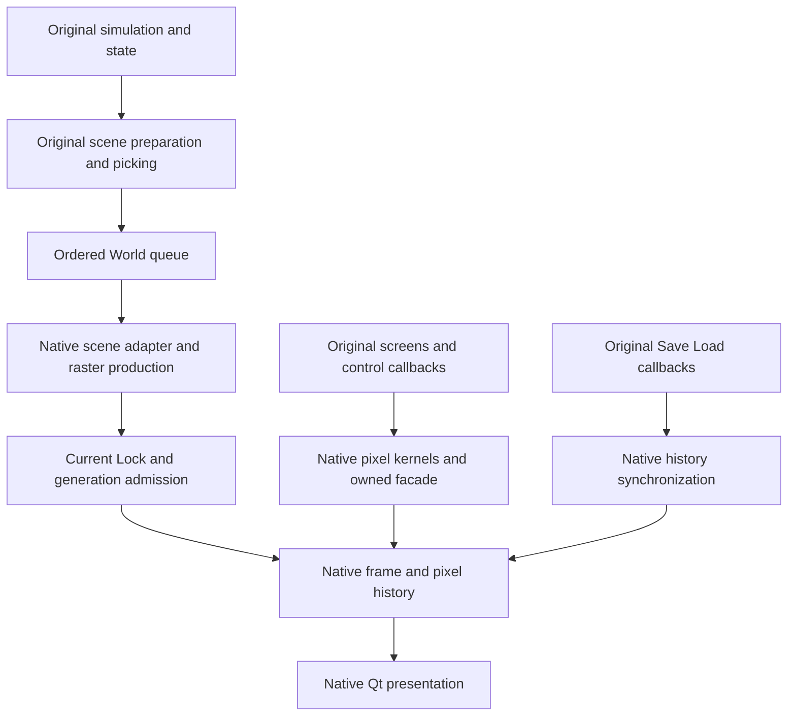

# Required original rendering dependencies

P1 now supplies the required caller/provider inventory and explicit recovery
frontiers for the declared native rendering target. The original dependency
recovery itself remains open where this inventory names unknown semantics,
ownership or natural callers. An inventoried call is not a recovered contract.

The [dependency decisions](../../docs/native-rendering-dependencies.json) classify
all 15 closure groups. The [byte-backed graph](rendering-p1-results-20261024/static-final02.json)
links the existing 14 journeys and 21 operation requirements, original anchors,
scoped behavior links, candidate call sites, external imports and source witnesses.
The [closure map](../../docs/native-rendering-closure.md) retains the same target
and acceptance denominator. This changes no game behavior or balance.

## What the running profiles require

The supported rendering target retains original simulation and validated
preparation. Native pixel ownership does not require replacing every upstream
routine with its offline reconstruction. The code makes the distinction explicit:

| Required native service | Retained original supplier |
| --- | --- |
| Device/surface backing, aliases, Lock/DC and release | Original graphics wrappers and shutdown orchestration. |
| World raster output, owned draw data and ordered frame delivery | Original scene construction, terrain/camera/lighting/animation preparation, sorting/visibility and required picking/state mutations. |
| Minimap and font pixel kernels | Original selector, projection, state production and call ordering. |
| Ordered current CPU/GPU history | Original storage/control callbacks after native synchronization. |
| Strict capability/fallback admission and Qt presentation | Original screen tick, control dispatch and simulation. |
| Native movie presentation when enabled | Original movie control/return coordination where admitted; disabled movies cannot satisfy the enabled-movies journey. |

`tools/prepare-menu-observer.py` stages the resident scene adapter; the strict
receipt list in `tools/native_only_contract.py` names ten graphics/menu DLLs.
The complete native cell producer is a separate opt-in in
`tools/prepare-scene-observer.py` and `tools/capture-scene-game.py`. It is not
silently part of that strict launch. Similarly, the standalone screen-tick,
minimap-selector and displacement-initializer models are not installed by those
profiles. Their missing installation is a separate upstream modernization task,
not automatically a failure to own pixels. Retained suppliers still need the
required input, side-effect and lifetime contracts; their original origin is not
an ownership guarantee.



## Actual ownership admission

The existing ordinary path has enforceable guards; no new guard is introduced:

1. `canvas_producers.c::bound` matches global canvas `658174` to a tracked
   surface pixel base. `canvas_producers_protect` terminates on failed batch
   admission rather than continuing an unknown canvas.
2. `world_raster_batch.c::batch_start` checks the extent, RGB565 state, allocation
   and protection window, native guard loan and stable surface identity.
3. `NativeDrawCpuGuardWorldV2` in `runtime/native-draw/history.h` matches native
   backing and, in mode3, requires exactly one same-thread Lock with no DC or
   storage DC and a valid single guard interval.
4. `RenderResidentWorldV1` in `runtime/render/owned_session.h` requires a unique
   current-thread/current-epoch full Lock, matching pixels/dimensions/pitch/masks
   and nonzero generation/nonce before publication.

These source checks justify a bounded tracked-surface admission boundary. They
are not a global alternate-slot exclusion. An alias of already admitted backing,
unknown upstream writers or the separate alternate source pointer cannot be
classified safe merely by matching a numerical address. B02 remains open.

## Original screen service contracts recovered statically

All addresses use No-CD SHA-256
`40209ca76705b5db04ea1974543bdec1739c68acdebdbefe2537ed025b8b7168`.
Fresh checks compare the selected function bytes and retained call edges against
that image. Original code is not executed by this analysis.

`RS.screen-cursor-background-invalidation` covers the entire 11-byte
`4a4370..4a437b`: write zero to DWORD `642c54`, then return. The body has no
callee, allocation, free or mutex operation. It invalidates saved-background
state; it does not release its pixels. Confidence is high for these static local
semantics. Caller lifetime and other writers remain separate.

`RS.screen-cursor-background-restore` covers the closed 302-byte local body
`4a4380..4a44ae`, with 83 decoded instructions and 92 CFG edges:

- Return when cursor enable `642c64` is zero, class `5e04c8` equals22, the ordinary
  source interface `6a49e4` is null, or any saved rectangle coordinate at
  `641a78/7c/80/84` is negative.
- Wait on `642c58` with `INFINITE`; the return value is ignored by this body.
- If `642c54` is nonzero, form a local rectangle starting at zero with wrapped
  right-minus-left and bottom-minus-top dimensions. Zero dimensions skip copying.
  This is not a positive-dimension/overflow check.
- Clamp negative saved offsets `641aa0/a4` to zero. If `6e1ee4` is nonzero, call
  deferred `58d5b0` with source receiver `641fc8`, destination `6a49e0`, the local
  rectangle and the selected offsets. Otherwise use direct `58c4a0`.
- Call ReleaseMutex after the normal path, including the no-copy case. The helper
  does not itself clear `642c54`.

Confidence is high for the local bytes, branch conditions and argument ordering.
Real mutex abandonment/failure ownership, copy/queue semantics, aliases, all
writers and faults/reentrancy in callees are separate. No native implementation,
original/native execution comparison or live replacement is claimed for either
helper.

## Required frontiers and scope decisions

| Frontier | Concrete dependency | Decision and remaining closure |
| --- | --- | --- |
| F1 / B02 | Alternate base `6e1f68`, source `6e1f6c` | Allocator, publisher, initial pixels, base/source relation, writers and release remain unknown. Ordinary admission permits work within its declared domain; it does not prove alternate unreachability or justify blanket exclusion. |
| F2 / B03 | Actual screen targets and service lifetime | The screen tick has 21 external calls. Its original comparison authors the service endpoints. The new 11-byte/302-byte static contracts close two local knowledge gaps; actual screen vtable targets and lifetime remain unresolved. |
| F3 / B09 | Five natural optional callers | PCX WORD `54b5f0`, brighten `58d770`, row copy `58d3b0`, raster15 `57e1b0`, camera3 `5532f0` remain provisional unused candidates. Their implementations/comparisons exist; no route is removed, forced or called globally unreachable. |
| F4 / B01 | Required lower providers and computed targets | A behavior anchor can cover only a branch or caller boundary. The graph retains unlinked direct targets and computed calls; each needs an actual required service contract or an explicit retained-original supplier boundary. Metadata absence alone is not missing code. |
| F5 / B11 | Provider compatibility | Current native/Wine acceptance remains bounded to tested providers. A legacy Windows host is not required to produce this graph. Legacy physical-driver and hardware-reset equivalence remain unvalidated, not passed or silently waived. |

The screen service frontier names `5571e0` selection, `4a5070` control dispatch,
`4a39a0` special service, `4a45b0` foreground cursor, `58ed80` fade and `58bf40`
presentation, plus virtual slots `0/4/8/0c/28/2c`. Their existing narrower contracts
remain suppliers only within their recorded scope. The dispatch register keeps
unresolved screen/virtual services explicitly incomplete.

Do not recursively port simulation, serializers or every resource provider just
to claim native rendering. Do not treat an original supplier or observed normal
run as proof that its lifetime is fully recovered. P2 should connect required
pixel/history/lifecycle providers; optional replacements of retained preparation
need their own explicit milestone. P3's reproduced readiness/performance failures
remain separate from this recovery inventory.

## Evidence and reproduction

The final static record checks 127 original anchors, 111 inventory function hashes,
874 candidate call sites and all 21 focused screen calls; five anchors are data
rather than code entries. It retains 153 computed call sites without a retained
target and 38 direct targets without a central address anchor. These are candidate
frontiers, not counts of missing implementations. The focused caller absent from
the inventory is included using its existing complete-body execution record.
No discovery inventory boundaries or unknown ranges are rewritten.

The two negative controls reject changed direct-target metadata and a changed
original image hash. Original-manifest bookends verify all2927 inputs.
The initial successful [static01](rendering-p1-results-20261024/static01.json)
retains its original source fingerprints; the final acquisition follows the
closure-map update. Both records are static, not new game/driver execution.

```sh
python3 /absolute/main/tools/working-retention.py --policy /absolute/P1/retention-policy.json run \
  --reserve-gib 0.02 -- python3 tools/reconcile-rendering-dependencies.py \
  --report research/runtime/rendering-p1-results-NEW/static.json
```

The temporary approved P1 floor is89.9GiB, with at most64MiB new outputs and no
installations or large builds. Its ignored policy, output-cap monitor, exact
review, source variants and restore-verified local SQLite backup are retained
under `working/coverage/rendering-p1-20261024/`. The repository's default90GiB
policy is unchanged. No cleanup, remote publication or runtime behavior change
is part of this acquisition.

## Superseding cursor helper execution (2026-10-25)

The static-only statements above describe the original P1 result.
[CSR1](screen-cursor-provider-recovery-20261025.md) adds portable borrowed-state
implementations and complete unchanged original-body comparison for4a4370 and
4a4380,including post-callback state rereads. A separate actual-provider matrix
connects original immediate/deferred copy and queue drainage to native surfaces
with complete independent destination checks and zero surviving owners.
The rest of F2 remains open:actual virtual targets,screen selection/control/
special services and full cursor/resource lifetime are not inferred from this
local proof. No reconstructed helper is installed in the public profile.

## Superseding screen-service and concrete lifetime recovery (2026-10-25)

[Screen selection, cursor selection and control dispatch](screen-services-recovery-20261025.md)
recover the complete local5571e0,4a39a0 and4a5070 callers and compare them with
unchanged original execution. The selector's20-entry cursor resource switch is
resolved. These direct services are no longer unassigned F2 semantics. Their
external gameplay,OS and virtual callback suppliers retain separate boundaries.

[Concrete screen lifetime recovery](screen-class-lifetime-recovery-20261025.md)
names132 shared-tick callback targets across22 tables and47 direct table-store
witnesses. For concrete class11 it additionally recovers storage construction,
pointer-vector retirement,callback publication,invocation and deletion,and the
six no-op tick endpoints. The generic virtual frontier remains incomplete:
other classes' resource/callback semantics,dynamic registration,indirect aliases,
enclosing retirement and real failure reachability are not closed by these
local comparisons. Earlier inventory/evidence records keep their original bytes.
